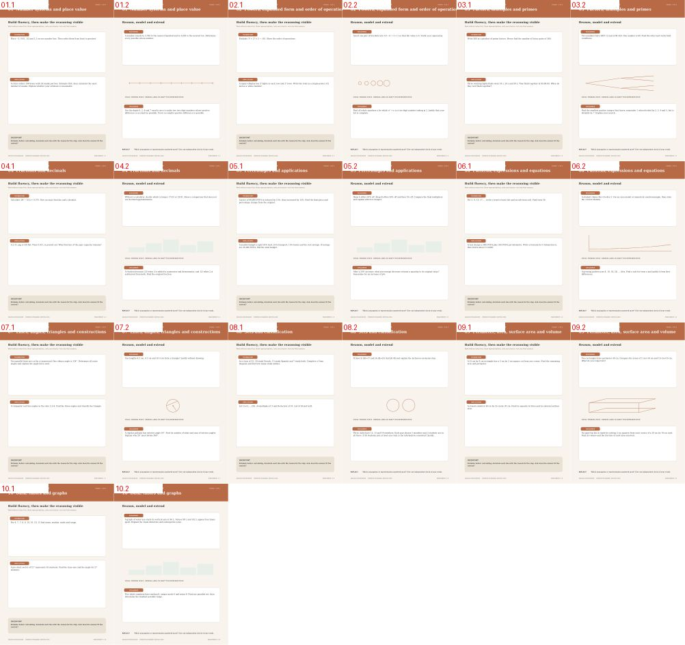
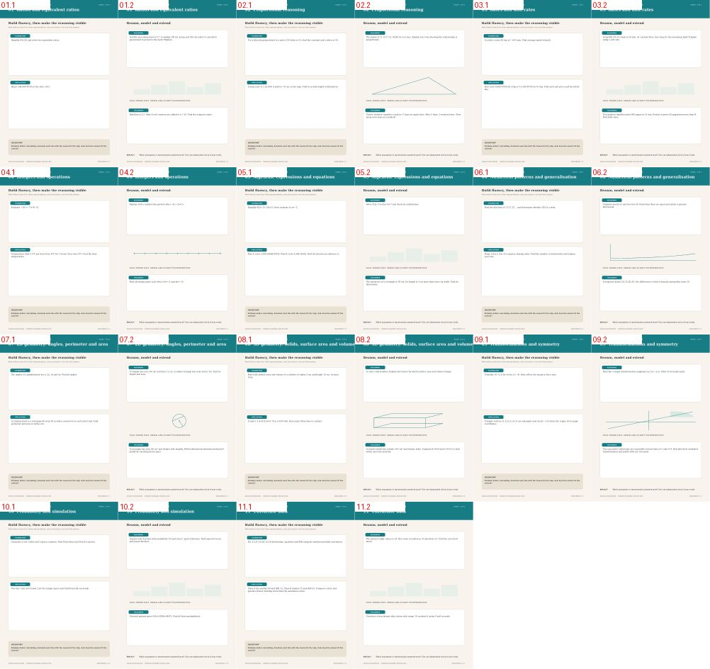
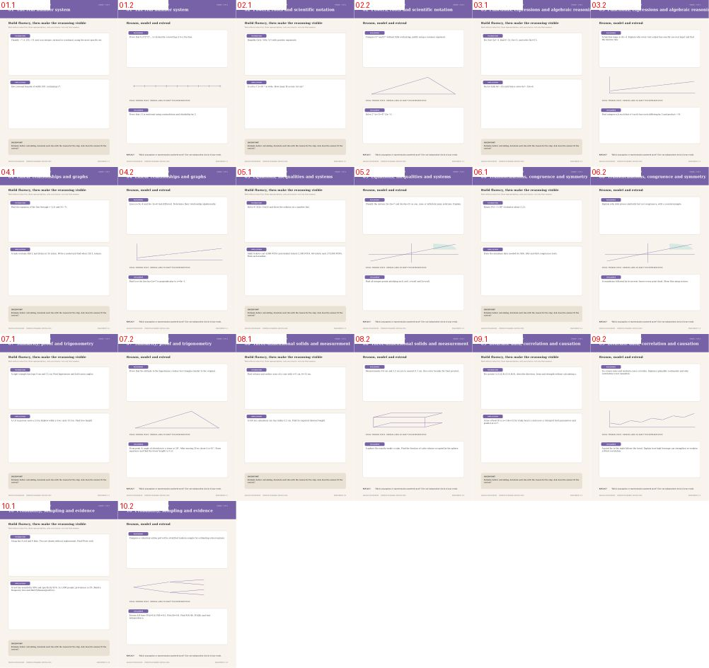
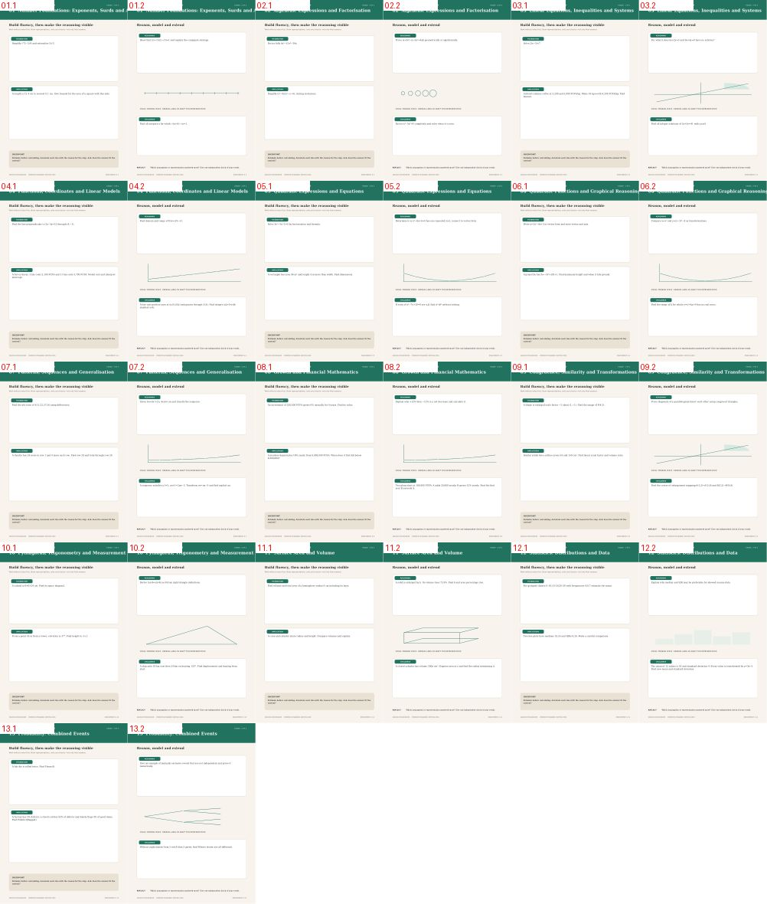
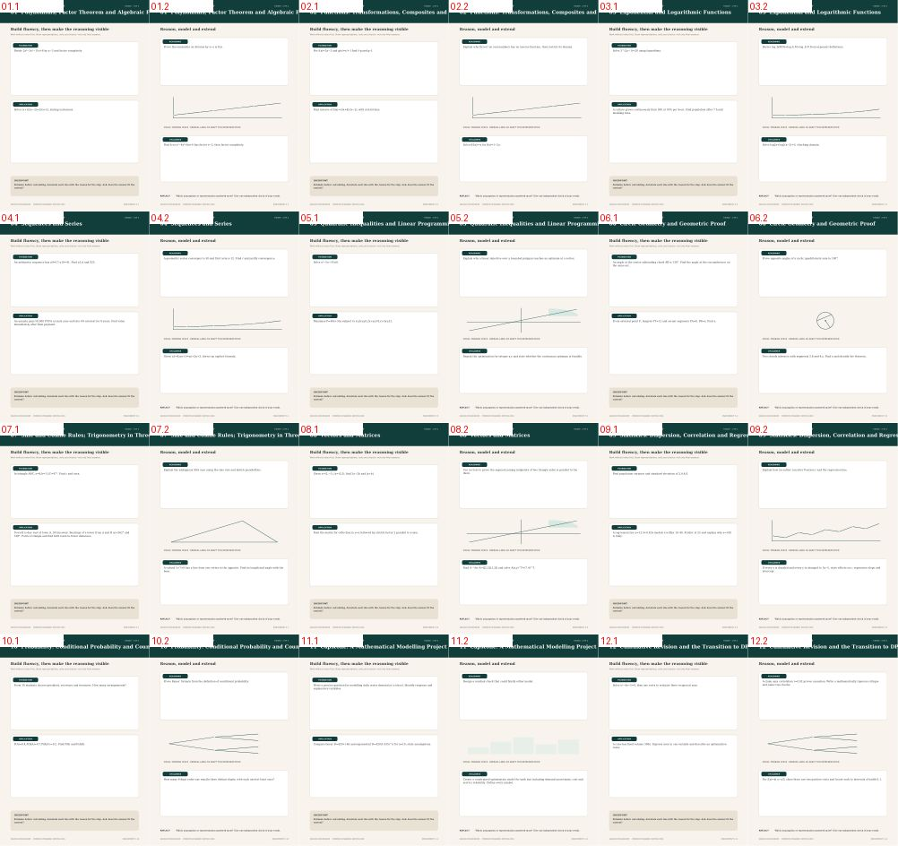

# Prévisualisation des cinq livres upgraded

Ouvrez chaque PDF ci-dessous pour parcourir le livre complet avant le merge.

## MYP Mathematics 1

**[Ouvrir le livre complet MYP 1 (261 pages)](MYP_Mathematics_1_Student_Coursebook_Upgraded_2026.pdf)**

## MYP Mathematics 2

**[Ouvrir le livre complet MYP 2 (283 pages)](MYP_Mathematics_2_Student_Coursebook_Upgraded_2026.pdf)**

## MYP Mathematics 3

**[Ouvrir le livre complet MYP 3 (295 pages)](MYP_Mathematics_3_Student_Coursebook_Upgraded_2026.pdf)**

## MYP Mathematics 4

**[Ouvrir le livre complet MYP 4 (485 pages)](MYP_Mathematics_4_Student_Coursebook_Upgraded_2026.pdf)**

## MYP Mathematics 5

**[Ouvrir le livre complet MYP 5 (365 pages)](MYP_Mathematics_5_Student_Coursebook_Upgraded_2026.pdf)**

## Corrigé de référence

**[Ouvrir le corrigé enseignant des nouveaux exercices](MYP_1-5_Premium_Enrichment_Educator_Answer_Reference.pdf)**

> Les livres originaux sont conservés. Dans chaque upgraded edition, une page-guide est placée après la couverture et un studio d’enrichissement de deux pages suit chacun des chapitres existants.
